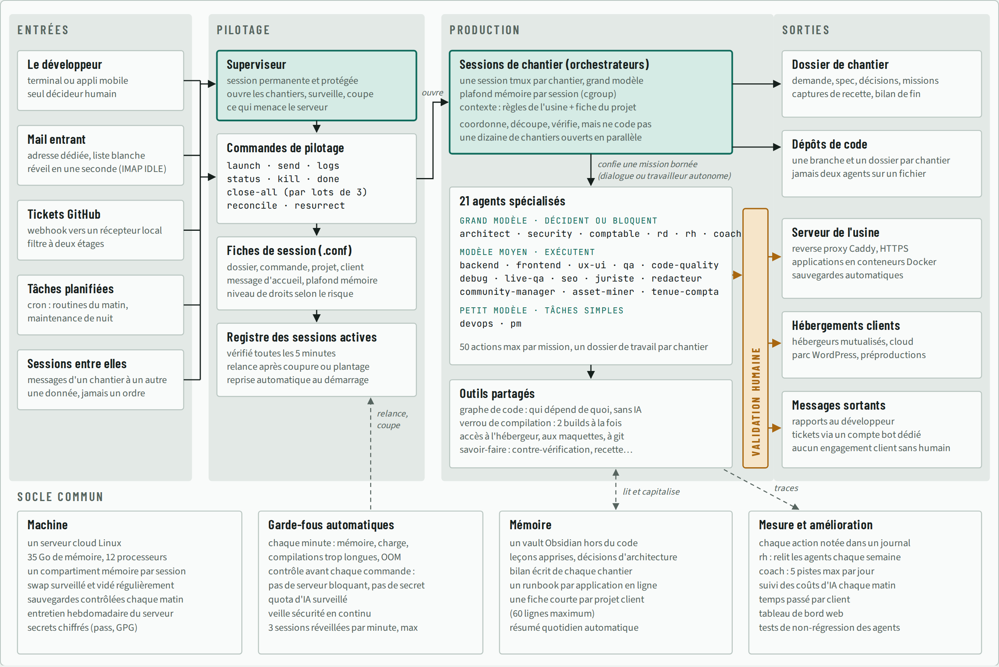

# La fabrique Pattes & Papilles

AI Week · jeudi 5 novembre 2026 · à distance

Aujourd'hui, votre agence ne travaille pas seule : elle pilote une équipe de sept agents IA. Chacun a un rôle écrit dans un fichier, tous partagent un dossier de chantier, deux d'entre eux peuvent bloquer la livraison. À la fin de la journée, une seule commande reconstruit tout votre livrable : diagnostic, tableau de bord, messages aux abonnés, business case, dossier et présentation.

C'est une version miniature de l'usine que Marius vous a montrée ce matin :



Votre fabrique en reprend les pièces : `AGENTS.md` pour les règles de l'usine, `agents/` pour les rôles, `chantier/` pour le dossier de chantier. Et vous êtes la barre orange, la validation humaine.

## Pourquoi cette journée

La grève vide la salle, alors on fait ce qu'on ne pourrait pas faire à trente : monter une vraie équipe d'agents IA, sur un vrai serveur. La journée est plus technique que les autres, mais elle est accompagnée pas à pas, et tout ce qu'elle produit sert le dossier et l'oral de vendredi.

Ce que vous y gagnez :

- **Pendant vos études** : une équipe d'agents réutilisable pour vos dossiers, votre mémoire, une étude de marché. On change les données, la demande et la charte, on relance.
- **En stage et en entretien** : un dépôt GitHub qui montre ce que vous savez faire, pas seulement ce que vous dites savoir faire.
- **Dans votre futur poste** : les agents ne remplacent pas le chef de projet, le stratège ou le responsable marketing. Ils déplacent leur travail vers le brief, le contrôle et la décision. C'est exactement ce que vous pratiquez aujourd'hui.
- **Votre différence** : un profil business qui ouvre un terminal, lit le journal d'un agent et écrit les règles d'une équipe d'IA, c'est encore rare.

Le dépôt reste à vous après la semaine, avec 60 heures de Codespace gratuites par mois sur un compte personnel.

## Le déroulé

| Heure | Séquence | Ce que vous faites |
|---|---|---|
| 9 h 00 | L'usine | Marius vous montre une vraie usine d'agents en production |
| 9 h 20 | Réflexion | Quatre questions sur l'usine, 10 minutes, ensemble |
| 9 h 30 | TD · Mise en route | Ensemble, écran partagé : dépôt, Codespace, premier agent |
| 9 h 55 | TP · Le terminal sans peur | Chasse au trésor dans les données, second agent en secours |
| 10 h 20 | Atelier 1 · Votre équipe | Vos règles et vos rôles d'agents |
| 10 h 45 | Atelier 2 · L'analyste et le stratège | Diagnostic, tableau de bord, business case |
| 11 h 45 | Atelier 3 · Toute la chaîne | Une commande, toute l'équipe, puis la pause |
| 13 h 30 | Coup de théâtre | Le client a un message urgent |
| 14 h 15 | Atelier 4 · Votre marque | Dossier et présentation aux couleurs de votre agence |
| 15 h 30 | Coaching | 15 minutes par agence, en visio |
| 16 h 30 | Clôture | Consignes pour vendredi |

## TD · La mise en route, ensemble (9 h 30 · 25 min)

Marius partage son écran, tout le monde fait la même chose en même temps. On ne passe à l'étape suivante que quand chacun a le même écran.

1. **Le compte.** Connectez-vous à GitHub, ou créez un compte gratuit.
2. **Le dépôt de l'équipe.** Une seule personne par équipe clique sur le bouton vert **Use this template**, puis **Create a new repository** (nommez-le comme votre agence). Elle invite ses coéquipiers : **Settings**, **Collaborators**, **Add people**.
3. **Le serveur.** Chacun, sur le dépôt de l'équipe : bouton vert **Code**, onglet **Codespaces**, **Create codespace on main**. Pendant les 2 à 3 minutes d'installation, GitHub vous prépare un petit serveur Linux rien que pour vous.
4. **La visite.** À gauche l'explorateur de fichiers, au centre l'éditeur, en bas le terminal (s'il n'apparaît pas : menu ☰, **Terminal**, **New Terminal**).
5. **Les trois premières commandes**, tapées ensemble : `pwd` (où suis-je ?), `ls` (qu'y a-t-il ici ?), `cat AGENTS.md` (lire un fichier).
6. **Brancher l'agent.** Tapez `agy`, ouvrez le lien affiché, connectez-vous avec votre compte Google, revenez au terminal, puis `/quit`.
7. **Premier contact.** `agy -p "Dis bonjour en une phrase"`. L'agent répond : votre serveur parle à l'IA.
8. **Premier agent de l'équipe.** `./fabrique.sh plan`, puis ouvrez `chantier/plan.md` dans l'explorateur. Le chef de projet vient de lire la demande du client et de répartir le travail.

## TP · Le terminal sans peur, en autonomie (9 h 55 · 25 min)

Jusqu'ici, vous avez utilisé l'IA dans des fenêtres : ChatGPT, NotebookLM, Make. Pour qu'une équipe d'agents travaille seule, il faut descendre d'un étage, là où elle tourne vraiment : un serveur Linux, piloté depuis un terminal. Pas besoin de devenir développeur. Il suffit de douze commandes et de quatre réflexes, rassemblés dans `outils/antiseche-terminal.md`.

**Partie 1 · Chasse au trésor**, dans le terminal, sans l'aide d'aucune IA :

1. Qu'y a-t-il dans le dépôt ? (`tree -L 1`)
2. Combien de clients compte `donnees/customers.csv` ? Attention, la première ligne est l'en-tête.
3. Affichez les 5 premières lignes de `donnees/abonnes_support.csv`. Comment s'appelle le chien de Damien ?
4. Combien de produits contiennent du saumon ? (`grep -i saumon donnees/products.csv`, puis ajoutez ` | wc -l`)
5. Ouvrez `AGENTS.md` avec `nano`, ajoutez votre prénom en dernière ligne, enregistrez, sortez. Vérifiez avec `tail -3 AGENTS.md`.

**Partie 2 · Le plan B.** Le quota gratuit d'un agent peut s'épuiser en pleine journée. Branchez le second :

1. Créez un compte sur [console.mistral.ai](https://console.mistral.ai), choisissez l'offre **Experiment** (gratuite), puis **API Keys**, **Create new key**. Copiez la clé.
2. Dans le terminal : `vibe --setup`, collez la clé.
3. Testez : `vibe -p "Dis bonjour en une phrase"`. Désormais, si un agent répond « quota » ou « 429 », vous lancerez la fabrique avec l'autre : `CLI=vibe ./fabrique.sh …`.

**Partie 3 · Bonus**

- Ouvrez une session `tmux`, détachez-vous, revenez (voir l'antisèche). Vous venez de faire ce que fait une usine d'agents toute la journée.
- Entrez dans votre Codespace en SSH depuis le terminal de votre propre ordinateur (fin de l'antisèche).

**Livrable** : les quatre réponses de la chasse au trésor et le « bonjour » de Vibe, dans le chat de l'équipe.

## Ce qu'il y a dans le dépôt

```
AGENTS.md                 les règles de l'usine, lues par chaque agent
agents/                   une fiche par rôle : chef de projet, analyste, stratège,
                          rédacteur, designer, relecteur, contrôleur
skills/redaction-humaine/ la skill d'écriture humaine construite en début de semaine
branding/                 la charte du client, et celle de votre agence (à remplir)
donnees/                  les données clients et leur dictionnaire
corpus/                   les documents de la marque
chantier/                 le dossier partagé où les agents travaillent
fabrique.sh               le chef d'orchestre
outils/                   l'antisèche du terminal, l'affichage des livrables
```

Le trajet d'une demande :

```
demande.md ─► chef de projet (plan)
                 │
                 ▼
             analyste ─► stratège ─┬─► rédacteur ─┐
                                   └─► designer  ─┤      en parallèle
                                                  ▼
                              relecteur ┬ contrôleur      bloquants, en parallèle
                                        │
                     refusé ? le rédacteur et le designer corrigent (2 fois au plus)
                                        ▼
                              chef de projet (bilan) ─► vous validez
```

## Atelier 1 · Votre équipe d'agents (10 h 20 · 25 min)

1. Lisez `AGENTS.md` et deux fiches de rôle au choix.
2. Relisez `chantier/plan.md`, produit pendant le TD. Le chef de projet a-t-il bien compris la demande ? Ce qui manque se corrige dans sa fiche, pas dans le plan.
3. Adaptez l'usine à votre agence : ajoutez dans `AGENTS.md` trois règles tirées de la bataille des supports d'hier (ce qui a fait céder votre agent, ce qui l'a protégé).
4. Ajoutez ou modifiez un rôle. Exemples : un agent « juriste » qui vérifie le RGPD des messages, un agent « veille » qui lit les avis clients, un agent « avocat du diable » qui attaque le business case.

**Livrable** : votre `AGENTS.md` et vos fiches de rôle, commités (onglet Source Control, message, Commit, Sync).

## Atelier 2 · L'analyste et le stratège (10 h 45 · 1 h)

1. `./fabrique.sh analyste` : l'agent écrit et exécute du Python sur vos données. Suivez son travail dans un second terminal : `tail -f chantier/logs/*analyste.log`.
2. Ouvrez le tableau de bord : `./outils/voir.sh`, onglet **Ports**, globe à côté du port 8000, puis `livrables/tableau-de-bord.html`.
3. Vérifiez un chiffre vous-mêmes, dans `chantier/analyse/chiffres.md` puis dans les données. Faux ? Corrigez la fiche `agents/analyste.md`, pas le résultat, et relancez.
4. `./fabrique.sh stratege` : segments, plan d'action, business case, recommandation par abonné.

**Livrable** : un tableau de bord dont vous avez vérifié trois chiffres à la main.

## Atelier 3 · Toute la chaîne (11 h 45 · 45 min)

1. Ouvrez une session qui survivra à la pause : `tmux new -s fabrique`, puis `./fabrique.sh` lance toute l'équipe, du plan au bilan. `Ctrl+B` puis `D` pour vous détacher, `tmux attach -t fabrique` pour revenir.
2. Pendant qu'elle tourne, regardez `chantier/journal.md` se remplir.
3. Lisez `chantier/relecture.md` et `chantier/controle.md` : qu'est-ce qui a été refusé ? Le refus était-il juste ?
4. Lisez trois messages de `chantier/livrables/messages-abonnes.md` comme si vous étiez Nadia. Les enverriez-vous ?

**Livrable** : `chantier/bilan.md`, et votre avis d'humain écrit à la fin.

## Atelier 4 · Votre marque (après-midi · 1 h 15)

Le matin, la fabrique a travaillé aux couleurs du client. L'après-midi, elle passe à celles de votre agence.

1. Remplissez `branding/agence.md` : nom, couleurs, polices, ton. Vous pouvez demander trois pistes à un agent, mais c'est vous qui tranchez.
2. Relancez la mise en forme avec votre charte : `MARQUE=branding/agence.md ./fabrique.sh redacteur designer relecteur`.
3. Comparez les deux versions de la présentation. Gardez la meilleure base pour l'oral de demain.

**Livrable** : `chantier/livrables/dossier.md` et `chantier/livrables/presentation.html` aux couleurs de votre agence.

## Les règles du jeu

- Vous êtes les seuls décideurs. Un agent propose, un humain valide, et le bilan dit qui a fait quoi.
- On corrige les règles (`AGENTS.md`, fiches de rôle), pas les livrables à la main. C'est ce qui rend la fabrique réutilisable.
- Un chiffre qui ne vient pas de `donnees/` n'existe pas.
- Commitez souvent : si un agent casse quelque chose, on revient en arrière.
- La fabrique lance les agents sans leur demander la permission avant chaque commande : c'est ce qui les rend autonomes, et c'est aussi un risque. Un fichier piégé dans `donnees/` ou `corpus/` pourrait leur faire exécuter n'importe quoi. Faites-la tourner uniquement dans le Codespace, jamais sur votre ordinateur, et n'y mettez ni mot de passe ni clé autre que celle de l'agent.
